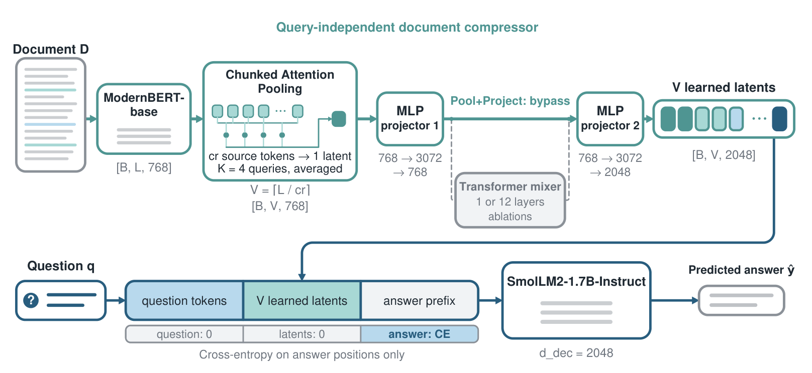

# What Should Occupy the Context Budget?

### Latent Compression versus Budget-Matched Truncation in Document QA

**Artem Cherepanov · Albina Burlova**<br>
HSE University · SaluteDevices<br>
Accepted at **DocInsights 2026 @ EMNLP**

[Paper](docs/paper.pdf) · [Poster](docs/poster.pdf) · [Reproduction guide](docs/reproduction.md) · [Reported results](results/paper_metrics.json) · [Citation](#citation)

When a decoder has room for only a short document context, what should occupy those positions? We compare learned latent vectors with retained text under the **same per-example decoder-context cap**. Each retention policy has a reader trained on its selected contexts.

Our strongest tested compressor, **Pool+Project**, encodes the document with ModernBERT, pools chunks into learned vectors, and projects them directly into the decoder's embedding space. The document representation is independent of the question and can be reused across questions. The decoder generates an answer conditioned on the question and latents.

<p align="center">
  
</p>

## Main results

Final-paper results on **3,000 held-out PwC QA pairs from 205 documents**, with SmolLM2-1.7B-Instruct. Perplexity and token accuracy are measured on teacher-forced answer tokens.

| System | PPL ↓, cr=8 | Token accuracy ↑ | PPL ↓, cr=16 | Token accuracy ↑ |
|:--|--:|--:|--:|--:|
| **Pool+Project** | **3.464** | **0.681** | **4.062** | **0.649** |
| First-N + matched reader | 5.584 | 0.610 | 6.473 | 0.585 |
| LLMLingua-2 + matched reader | 5.563 | 0.608 | 6.609 | 0.580 |
| BM25 + matched reader | 5.349 | 0.620 | 6.565 | 0.584 |

Here `cr` is the encoder-side pooling factor. A document of `L` encoder tokens produces `ceil(L / cr)` latent positions. Retention baselines receive that many available decoder-token positions. Discrete text selectors can leave some positions unused.

The uncompressed **frozen** full-document reference has PPL **3.653** and token accuracy **0.719**. It uses a different context budget and reader training protocol from the rows above.

Adding a post-pooling transformer reduces quality in the tested one-layer and twelve-layer settings. The twelve-layer comparison repeats in the discovery run, two paired replications, and a second decoder family, Qwen2.5. Removing the twelve-layer block saves **86.4M non-decoder parameters**. Forward time falls from **72.8 to 68.5 ms** at cr=8 in the paper's A100 microbenchmark.

The paper also reports first-sentence generation and document-clustered paired intervals. The study covers short English documents and two small decoder families. Full protocols and scope are described in the [paper](docs/paper.pdf).

## Installation

Use **Python 3.11**. Full training requires a CUDA GPU. Run these commands from the repository root in a fresh environment:

```bash
python3.11 -m venv .venv
source .venv/bin/activate
python -m pip install --upgrade pip
python -m pip install torch==2.5.1 --index-url https://download.pytorch.org/whl/cu124
python -m pip install -r requirements.txt
python -m pip install -r requirements-gpu.txt
```

The CUDA 12.4 command assumes a compatible NVIDIA driver. The recorded training environment used PyTorch 2.5.1, Transformers 4.57.6, and Liger 0.8.x. Core package pins are recorded in [requirements.txt](requirements.txt); additional utility versions are release dependencies rather than a recovered lockfile of every historical run.

For LLMLingua-2 selection:

```bash
python -m pip install -r requirements-selectors.txt
```

Models and data are fetched from Hugging Face on first use. The principal dependencies are [ModernBERT-base](https://huggingface.co/answerdotai/ModernBERT-base), [SmolLM2-1.7B-Instruct](https://huggingface.co/HuggingFaceTB/SmolLM2-1.7B-Instruct), and the [PwC dataset](https://huggingface.co/datasets/sggetao/PwC). Mixer ablations also use the [ViT-Base configuration](https://huggingface.co/google/vit-base-patch16-224). Each upstream asset retains its own license and terms.

## Train and evaluate

Start with the [reproduction guide](docs/reproduction.md). It gives explicit commands for the paper's Pool+Project recipe, evaluation at cr=8 and cr=16, depth and pooling ablations, and selector-specific readers.

```bash
python src/train_cvlm.py --help
python src/train_sft.py --help
python src/eval_cvlm.py --help
```

The model, encoder, and decoder are trained jointly in the main experiment, with encoder input embeddings held fixed. The historical `vision` / `vit` names in the code also denote text latents and the optional transformer block. **`--no_vit true` selects Pool+Project.** The default `--vit_num_layers 0` means the full ViT stack, so it does not select the zero-layer model.

## Repository contents

| Path | Contents |
|:--|:--|
| `src/modeling.py` | Compressor, decoder integration, and architecture variants |
| `src/train_cvlm.py` | Joint training with compression curriculum and checkpoint manifests |
| `src/train_sft.py` | Readers trained on first-N, BM25, or preselected contexts |
| `src/eval_cvlm.py` | Answer-token metrics, generation, and per-example dumps |
| `tools/` | Selection, paired document-cluster statistics, and diagnostics |
| `tests/` | CPU tests and optional CUDA/Liger checks |
| `docs/` | Final paper, poster, and reproduction instructions |
| `results/paper_metrics.json` | Aggregate values transcribed from the final paper, with table references |
| `hse/` | Historical Slurm recipes tied to the original cluster |

## Released artifacts

This release includes the training and evaluation code, tests, final paper, poster, and reported aggregate metrics. **Trained checkpoints and original per-example evaluation dumps are not included.** Training is therefore required before running checkpoint-based evaluation. The reported metrics are transcriptions of the final paper, not outputs generated by installing this repository.

PwC pairs third-party source documents with model-generated QA. Download it from the upstream dataset repository. Source documents, dataset-derived sample embeddings, and text-bearing evaluation dumps are excluded from this release. The [artifact notes](docs/artifacts.md) describe the available evidence and files produced by a new run.

## Tests

Tests use small synthetic fixtures and do not require model weights or the dataset. On a CPU-only Linux installation, install the CPU PyTorch wheel instead of the CUDA wheel above, omit `requirements-gpu.txt`, and run:

```bash
python -m pip install -r requirements-dev.txt
HF_HUB_OFFLINE=1 HF_DATASETS_OFFLINE=1 TRANSFORMERS_OFFLINE=1 \
DISABLE_LIGER=1 TRACKIO_DISABLE=1 python -m pytest -q
```

CUDA and fused-kernel checks skip when their dependencies are unavailable.

## Citation

```bibtex
@misc{cherepanov2026contextbudget,
  title = {What Should Occupy the Context Budget? Latent Compression versus Budget-Matched Truncation in Document QA},
  author = {Cherepanov, Artem and Burlova, Albina},
  year = {2026},
  note = {Accepted at the DocInsights Workshop at EMNLP 2026},
  url = {https://github.com/LuLim14/CVLM-in-Doc-QA}
}
```

## Acknowledgments

This work is an output of a research project (HSE-BR-2025-025) implemented as part of the Basic Research Program at HSE University.
