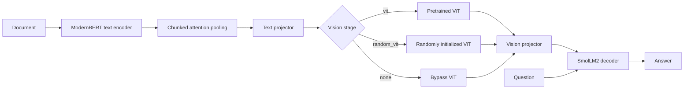
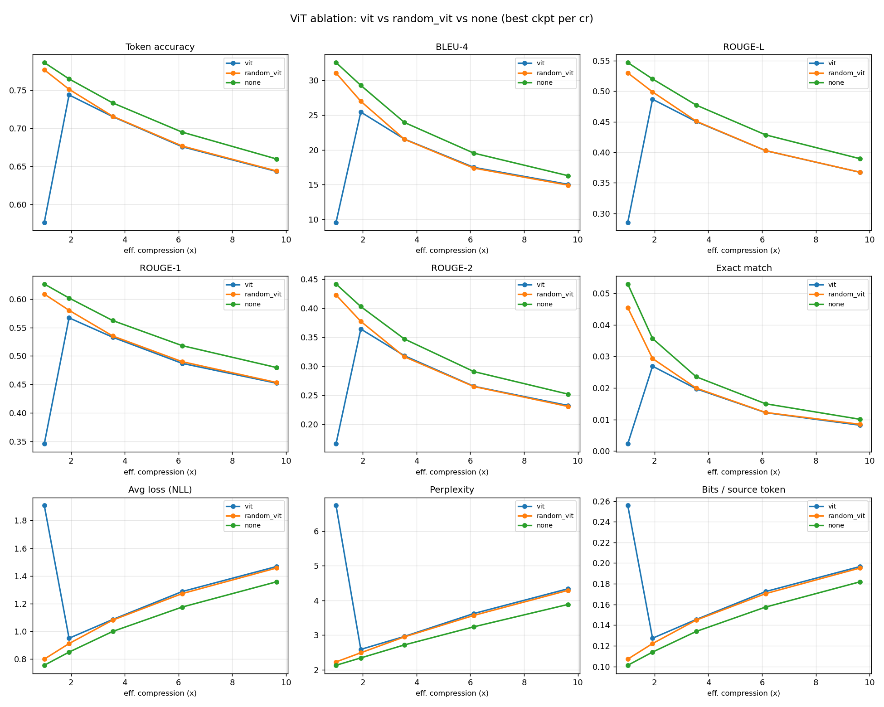

# CVLM for Document Question Answering

**Can a document be compressed into a short sequence of learned embeddings and still answer questions about it?** This research code studies that question with a text encoder, a chunked attention pool, an optional Vision Transformer (ViT), and a language model decoder.

The repository includes training and evaluation pipelines, a supervised fine-tuning (SFT) baseline, tests, and a three-arm ViT ablation. It is a research prototype rather than an installable Python package.

## How it works



The document is encoded at training and inference time. The pool reduces its token sequence according to the compression rate; the question stays in the decoder prompt. The three vision backends let us test whether a pretrained ViT, its architecture without pretrained weights, or neither helps document QA. See [`src/modeling.py`](src/modeling.py) for the model and [`src/cvlm_dataset.py`](src/cvlm_dataset.py) for data handling.

## Ablation snapshot

The included results compare the three vision backends across compression settings. This dashboard plots the best checkpoint selected for each setting:



At configured compression rate 4, the recorded effective context reduction is **3.55×**:

| Vision backend | Token accuracy ↑ | ROUGE-L ↑ | BLEU-4 ↑ | Perplexity ↓ |
| --- | ---: | ---: | ---: | ---: |
| Pretrained ViT | 0.7152 | 0.4503 | 21.55 | 2.9596 |
| Random ViT | 0.7157 | 0.4510 | 21.51 | 2.9467 |
| No ViT | **0.7331** | **0.4774** | **23.94** | **2.7148** |

These are results from the checked-in ablation artifacts, not a claim that the same ranking holds on other datasets or runs. See the [full metrics table](vit_abl_metrics/metrics_table.csv), [individual plots](vit_abl_metrics/), and [representation analysis](vit_abl_metrics/repr/RUN.md).

## Run a small experiment

The scripts expect Linux, a CUDA GPU with enough memory for the selected models, Python 3.10+, and access to Hugging Face models and datasets. The default model stack is SmolLM2-1.7B-Instruct, ModernBERT-base, and ViT-base-patch16-224. Install a PyTorch build suitable for your CUDA environment, then install the Python dependencies used by the scripts:

```bash
python -m pip install transformers datasets safetensors liger-kernel numpy tqdm \
  sacrebleu rouge-score matplotlib trackio pytest
```

`pyproject.toml` contains lint and type-checker settings; it does not define an installable package or pin runtime dependencies.

From the repository root, this example limits the dataset, disables the longer LongBench sweep, and writes artifacts to a local directory:

```bash
OUTPUT_DIR="$PWD/runs/smoke" \
MAX_SAMPLES=128 EVAL_MAX_SAMPLES=32 \
EPOCHS=1 BATCH_SIZE=1 GRAD_ACCUM=1 \
COMPRESSION_RATE=4 CR_SCHEDULE='' EVAL_CR_SCHEDULE='' \
MAX_VISION_LEN=256 EVAL_MODES=cvlm \
EVAL_ALL_CHECKPOINTS=0 LONGBENCH_EVAL=0 \
TRACKIO_DISABLE=1 \
bash scripts/run_full_pipeline.sh
```

The pipeline saves `model_step_*.safetensors`, `eval_cvlm.json`, and `pipeline.log` under `OUTPUT_DIR`. Set `SKIP_TRAIN=1` with an existing run directory to evaluate a saved checkpoint. The default full pipeline also evaluates language-model baselines and LongBench QA tasks; inspect the environment variables near the top of [`scripts/run_full_pipeline.sh`](scripts/run_full_pipeline.sh) before a larger run.

To run the full-document SFT baseline, use [`scripts/run_sft_pipeline.sh`](scripts/run_sft_pipeline.sh) with a separate `OUTPUT_DIR`. Use `VISION_BACKEND=vit`, `random_vit`, or `none` with separate run directories for the vision-stage comparison.

## Repository guide

| Path | Contents |
| --- | --- |
| [`src/`](src/) | Model, dataset, training, evaluation, and logging code |
| [`scripts/`](scripts/) | CVLM and SFT pipeline entry points |
| [`tests/`](tests/) | Unit and smoke tests for compression, model behavior, and logging |
| [`vit_abl_metrics/`](vit_abl_metrics/) | Ablation plots, CSV metrics, and representation-analysis artifacts |
| [`pyproject.toml`](pyproject.toml) | Ruff and mypy configuration |

Run the tests from the repository root with `PYTHONPATH=src python -m pytest tests`. Some tests require the model dependencies above; the GPU smoke test requires a compatible CUDA environment.
